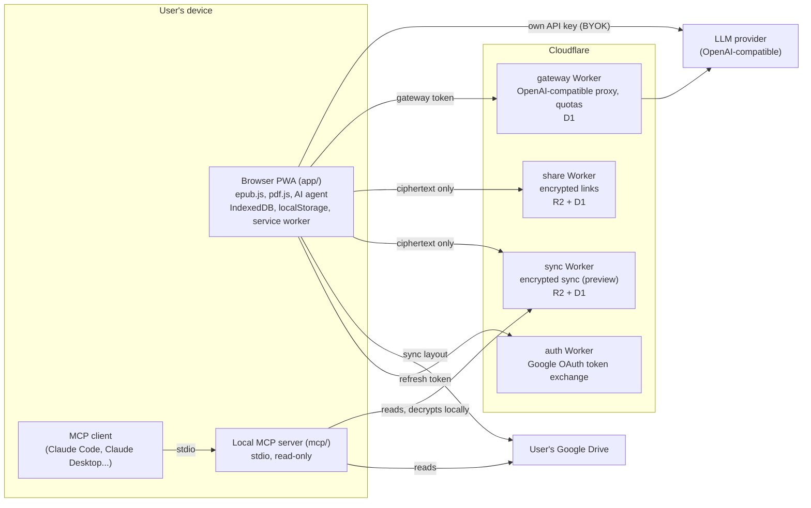

# BookReader

BookReader is an EPUB and PDF reader that runs in the browser as an installable PWA. Its AI agent answers from the book you are reading, cites the passage it used, and generates study material: flashcards, summaries, mind maps and infographics. The library stays on the device, and server components exist only for features that cannot work without one.

- Live app: <https://bookreader.raiatech.com>
- Author: Luis González
- Case study: <https://luisgonzalezbernal.com/engineering.html#bookreader>

**Language note:** [`DECISIONS.md`](DECISIONS.md), most of [`docs/`](docs/), [`mcp/README.md`](mcp/README.md), code comments and many test names are in Spanish. The app itself has English and Spanish interfaces.

## Architecture



The static site and app are served by Cloudflare Pages. The local MCP server can also read a backup file with no network access. The sync Worker additionally hosts a remote MCP endpoint, described under [Key engineering decisions](#key-engineering-decisions).

## Stack

| Area               | What is used                                                                                                                                                                                                 |
| ------------------ | ------------------------------------------------------------------------------------------------------------------------------------------------------------------------------------------------------------ |
| App                | Vanilla JavaScript ES modules, no framework, no bundler                                                                                                                                                      |
| Vendored libraries | epub.js 0.3.93, pdf.js 3.11.174, JSZip 3.10.1, sql.js 1.13.0, Temml 0.13.3, Mermaid 12.1.0, fsrs-browser 6.6.0 ([`app/vendor/`](app/vendor/), same origin, loaded on demand under a `script-src 'self'` CSP) |
| Browser storage    | IndexedDB, localStorage, Cache API through a service worker                                                                                                                                                  |
| Backend            | Cloudflare Pages, Workers, D1, R2 (four Workers in [`workers/`](workers/))                                                                                                                                   |
| LLM access         | Any OpenAI-compatible endpoint. Presets are in [`app/js/ai/llm.js`](app/js/ai/llm.js); the default provider is nan.builders                                                                                  |
| MCP server         | Node.js, `@modelcontextprotocol/sdk` ^1.30.1                                                                                                                                                                 |
| Tests and tooling  | Playwright ^1.61.1, `node:test`, ESLint ^10.6.0, Prettier ^3.9.4, Wrangler ^4.110.0                                                                                                                          |

## Key engineering decisions

[`DECISIONS.md`](DECISIONS.md) holds 61 ADRs (counted by `## ADR-` headings), each with context, decision, rationale and consequences.

- **End-to-end encrypted sharing ([ADR-053](DECISIONS.md#adr-053--compartir-por-enlace-el-dossier-pasa-por-un-servidor-nuestro-pero-cifrado-de-extremo-a-extremo--aceptada)).** A shared shelf is encrypted in the sender's browser with AES-GCM 256 and a random per-link key ([`app/js/share/link.js`](app/js/share/link.js)). The key travels in the URL fragment, which browsers do not send, so the server stores bytes it cannot read. Links expire after 7 days. The Worker reserves capacity in D1 before touching R2 and refuses uploads at 80% of the R2 free tier, so the feature cannot generate a bill.
- **Deterministic plan validation ([ADR-049](DECISIONS.md#adr-049)).** The agent proposes how many flashcards each chapter deserves, but `validatePlan` in [`app/js/ai/card-plan.js`](app/js/ai/card-plan.js) decides what is accepted. It drops unknown or duplicate chapters, caps each chapter, and normalises the sum to the requested total. An invalid response gets one retry, then falls back to a proportional split, so a bad model response cannot block generation.
- **Deterministic checks before an LLM judge from another model family ([`docs/EVALS.md`](docs/EVALS.md)).** Anything code can check (anchors, JSON shape, cloze syntax, duplicates, language) is checked by [`evals/check.mjs`](evals/check.mjs), and a failed gate caps the artifact's score. [`evals/judge.mjs`](evals/judge.mjs) scores only what needs judgement. By default `deepseek-v4-flash` generates and `glm5.3-flash` judges, to avoid self-preference bias. `EVAL_JUDGE` can override this, and code does not enforce the separation. [ADR-050](DECISIONS.md#adr-050) records why this judge was chosen.
- **Quality budgets written before the change ([ADR-050](DECISIONS.md#adr-050)).** A change that affects agent quality starts with a named baseline run, a primary metric and a time-box. [`evals/budgets.mjs`](evals/budgets.mjs) versions the thresholds, and `npm run eval:score` exits non-zero when one breaks. A missing metric counts as broken. `docs/EVALS.md` also records failures and reverted changes, including a prompt change that made the agent write Spanish flashcards for an English book.
- **Read-only local MCP server ([ADR-036](DECISIONS.md#adr-036--el-mcp-es-un-puente-local-de-solo-lectura-y-vive-en-su-propia-carpeta--aceptada)).** External agents reach the library through a stdio bridge in [`mcp/`](mcp/) that opens no ports. Write tools are not advertised locally, because no local source can write. [`mcp/src/redact.mjs`](mcp/src/redact.mjs) strips API keys, refresh tokens and device IDs from tool output, and tests plant secrets to verify it.
- **Remote MCP is a separate trade-off.** The sync Worker also serves MCP over HTTP, with token-scoped write tools ([`workers/sync/src/mcp.js`](workers/sync/src/mcp.js)). To answer, it holds the sync key encrypted under a key derived from the user's token and decrypts in memory during each query. That is less private than the local bridge, and [`mcp/README.md`](mcp/README.md) says so.
- **Encrypted managed sync ([ADR-056](DECISIONS.md#adr-056--sync-de-bookreader-sync-gestionado-dentro-de-la-suscripción-con-el-patrón-de-compartir--aceptada-ab--a-y-drive-gratis-en-adr-060)).** The sync key is random and generated on the first device, not derived from the licence, and passes between devices in a link fragment ([`app/js/sync/sync-crypto.js`](app/js/sync/sync-crypto.js)). The cost is accepted and documented: losing all devices and the recovery phrase loses the synced data. This Worker is deployed in preview and hidden from Settings by default. Sync through the user's own Google Drive is the other provider behind the same engine.
- **Gateway with atomic quotas ([ADR-021](DECISIONS.md#adr-021--gateway-de-tokens-propios-workerd1-alias-de-modelos-403-al-agotar--aceptada)).** Quota is decremented with `UPDATE ... WHERE remaining > 0 RETURNING` in D1. Own model aliases hide provider names, so a provider can change without breaking saved configurations. Exhausted quota returns 403 rather than 429, because the client retries 429s. Only allowlisted parameters are forwarded upstream, and streamed bodies pass through unparsed.
- **Provider contract tests ([ADR-030](DECISIONS.md#adr-030)).** `@live` tests against real models assert capabilities (a `tool_call` came back, the stream parsed), never content, which keeps them stable.
- **No agent framework ([ADR-023](DECISIONS.md#adr-023--no-adoptar-langgraph-la-orquestación-se-mantiene-hand-rolled--aceptada)).** Orchestration is plain control flow in ES modules. The ADR records the conditions under which this should be reconsidered.
- **Deploys come from a commit ([`scripts/build-pages.mjs`](scripts/build-pages.mjs)).** The build extracts `HEAD` with `git archive` and copies an allowlist of paths, so uncommitted work and repo-only files cannot be published. It refuses a commit that is not on `origin/main` unless explicitly overridden. It stamps `build.json`, and the post-deploy smoke test asserts that production serves that commit.

## Testing and evals

There is no CI configuration in this repo. Tests run locally, and `npm run deploy:pages` runs the smoke test after deploying.

| Command                 | What it does                                                                               | Needs                  |
| ----------------------- | ------------------------------------------------------------------------------------------ | ---------------------- |
| `npm test`              | Deterministic Playwright E2E tests (excludes `@live`, `@eval`, `@smoke`, `@race`, `@perf`) | Chromium               |
| `npm run test:gateway`  | Gateway Worker tests, `node --test`                                                        | Node                   |
| `npm run test:share`    | Share Worker tests, `node --test`                                                          | Node                   |
| `npm run test:sync`     | Sync Worker and remote MCP tests, `node --test`                                            | Node                   |
| `npm run test:mcp`      | MCP server tests, including a real MCP client talking to the server as a child process     | Node, `mcp` installed  |
| `npm run smoke`         | Smoke test against the production deployment                                               | Network                |
| `npm run perf`          | Reader performance budgets. Run alone, because parallel work skews the measurements        | `eval:fixtures` output |
| `npm run test:ai`       | `@live` end-to-end behaviour against a real model                                          | `NAN_API_KEY`          |
| `npm run test:provider` | Provider capability contract                                                               | `NAN_API_KEY`          |
| `npm run eval:fixtures` | Downloads the eval books and builds a test magazine                                        | Network                |
| `npm run eval:smoke`    | Short eval run. Reports broken budgets without failing                                     | `NAN_API_KEY`          |
| `npm run eval`          | Full eval: generate, deterministic checks, judge, report. Costs API credits                | `NAN_API_KEY`          |
| `npm run lint`          | ESLint over `app/js`, service workers and `mcp`                                            | Node                   |
| `npm run format:check`  | Prettier check                                                                             | Node                   |

Counts on 2026-11-05, from a clean export of `HEAD`:

| Suite                   | Count                  | How it was obtained                                                                |
| ----------------------- | ---------------------- | ---------------------------------------------------------------------------------- |
| `test:gateway`          | 56 passing             | Ran it                                                                             |
| `test:share`            | 13 passing             | Ran it                                                                             |
| `test:sync`             | 82 passing             | Ran it                                                                             |
| `test:mcp`              | 126 passing            | Ran it                                                                             |
| `npm test` (Playwright) | 972 tests in 175 files | Listed with `npx playwright test --list` and the same tag filter; not a pass count |

The gateway and sync Worker tests run against real SQLite (`node:sqlite`) with the same migrations as production, rather than a hand-written D1 double. WebKit regressions run with `npx playwright test <spec> --config=playwright.webkit.config.ts`.

Playwright serves the app on port 8888 and the repo root on port 8899 ([`playwright.config.ts`](playwright.config.ts)), and reuses any server already listening there. If something else holds port 8888, free it or use a config that overrides `use.baseURL` and `webServer`.

## Run locally

Requires Node.js. The commands below were checked with Node 22.23.4; the gateway and sync Worker tests need a version that includes `node:sqlite`.

```bash
git clone https://github.com/iamluisgb/bookreader.git
cd bookreader
npm ci
npm --prefix mcp ci
npx playwright install chromium

# The app has no build step
node scripts/test-server.mjs 8000 app   # app at http://localhost:8000/
node scripts/test-server.mjs 8000 .     # or: landing at /, app at /app/
```

To use the agent, set an OpenAI-compatible base URL and API key in the app's settings. Only `@live` and `@eval` runs need a `.env`, created from [`.env.example`](.env.example).

To try the MCP server with the repo's fixture and no credentials:

```bash
node mcp/cli.mjs --backup mcp/test/fixtures/backup.json tools
node mcp/cli.mjs --backup mcp/test/fixtures/backup.json list_books
node mcp/server.mjs --backup mcp/test/fixtures/backup.json   # MCP server on stdio
```

## Repo layout

```text
app/                  The PWA
  js/                 Reader, library and app orchestration
  js/ai/              Agent: retrieval, LLM client, flashcards, summaries, study
  js/share/           Share links and their encryption
  js/sync/            Sync engine, Drive and BookReader providers, encryption
  css/ fonts/ icons/  Styles and static assets
  vendor/             Vendored third-party libraries
  sw.js               Service worker
workers/
  gateway/            OpenAI-compatible proxy with quotas
  share/              Encrypted share links
  sync/               Encrypted sync and remote MCP
  auth/               Google OAuth token exchange
mcp/                  Local MCP server and CLI
tests/                Playwright specs and fixtures
evals/                Batteries, checks, judge, budgets, report
scripts/              Pages build, test server, usage reports
docs/                 Eval method, audits, research, guides
odd/tasks/            Per-task contracts and close-outs
index.html es/ anki/ why/ privacy/ s/ u/ assets/    Public site pages and assets
DECISIONS.md          ADRs
BACKLOG.md            Pending work
CHANGELOG.md          Delivered work
DESIGN.md             Visual language and design tokens
```
