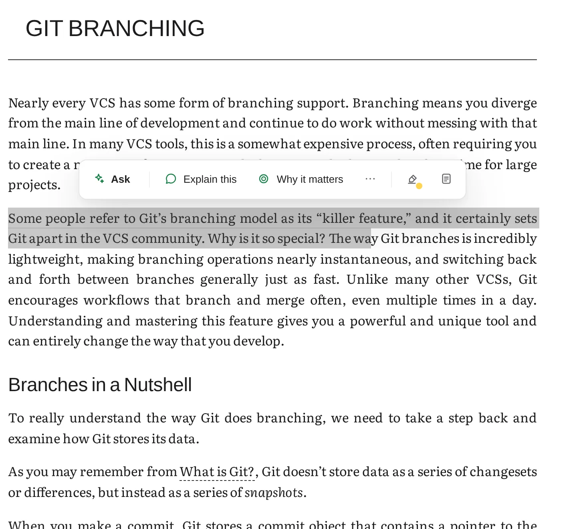

# Ask the book

The agent answers **with the book in front of it**: it finds the passage that matters, shows it to
you and writes the answer citing it. It does not search the web and does not make up sources; if
something is not in the book, it says so.

## The quick way: select and choose

Select some text and the action bar appears. The top ones are the usual questions:

<figure markdown>
  
  <figcaption>Select and choose: the bar carries the usual questions and, under “…”, the rest and highlighting.</figcaption>
</figure>

| Action                  | What it does                                                         |
| ----------------------- | -------------------------------------------------------------------- |
| **Explain this**        | Tells you in plain words, with a concrete example.                   |
| **Why it matters**      | Connects it to your reading goal.                                    |
| **What it means here**  | The author's definition, not the dictionary's.                       |
| **Where else**          | Looks for the same subject in another chapter.                       |
| **Strongest objection** | Argues against it: useful for reading with judgement.                |
| **With numbers**        | Turns the example into something measurable, when the book has data. |

From the same bar you can **highlight** in one tap (with the last colour), add a **note**, **copy**,
**share** a quote card, **send the passage to the notebook** or **start writing** your own question
with the passage attached.

!!! tip "Two of them need a goal"
    **Why it matters** and **With numbers** need a **reading goal**. If you have not picked one, the
    app asks for it: it is what makes the answer yours instead of a generic summary.

## Asking by hand

Open the agent with **✦** (or `]`) and type. You can:

- Ask about the chapter you are reading or about the whole book.
- Pick a **reading goal** and a **notebook template** for that conversation.
- Ask it to answer in your language even when the book is in another: it searches the original and
  replies in yours, quoting the original passage.
- Attach a **figure or equation** (PDF): select an area and send it with the question.

## Citations: you can check the answer

Under each answer there are citations with their chapter and page. Tap one and the reader jumps to
the passage. That is the difference between "the agent says" and "the book says": if the citation
does not support the answer, the place to check it is right there.

<figure>
  
  <figcaption>Every answer brings its citation and its page. The original passage is one tap away.</figcaption>
</figure>

## Feynman mode: you explain it

Instead of asking, you explain the concept and the agent plays sparring partner: it tells you what
is missing, what is weak and what you got right, without giving you the answer first. Open it from
the agent's menu.

## The question at the end of a chapter

With the **HQ&A** template active, when you start a new chapter the agent asks **one recall
question** about the previous one. It does not give the answer: it is a check that what you read
stuck. It only asks forwards and once per chapter.

## If the answer does not help

- **"I cannot find that in this book"**: the term does not appear as typed. Try the author's words,
  or ask **Where else**.
- **It cites a passage and the answer wanders**: make the question smaller. The agent does better
  with "what does it say here about X" than with "summarise the chapter".
- **No agent at all**: see [Set up the agent](set-up-ai-key.md).

## Next step

- [Turn reading into review](turn-reading-into-review.md).
- [How the agent answers](../explicacion/how-the-agent-works.md), with its limits.

---

_Updated on 15 November 2026._
