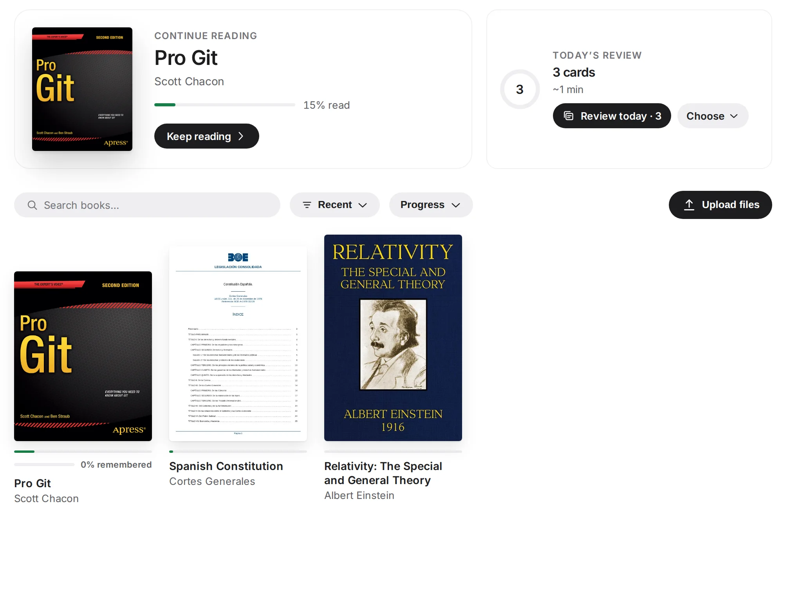

# Import a book

BookReader reads **EPUB and PDF without DRM**. There is no account and no book server: the file
stays in your browser's storage, on this device. If you want it on another device, you sync later
(or upload it again).

<figure markdown>
  
  <figcaption>The library: your books, the one you are reading and the review due today.</figcaption>
</figure>

## Before you start

- An **EPUB** or a **PDF** you can open without Amazon's or Adobe's app. If your book only opens in
  Kindle, it has DRM and BookReader cannot read it.
- A **scanned PDF** (a photo of each page) displays fine, but it has no text: the agent cannot
  search inside it or quote passages. Fine for reading, useless for asking.

## Three ways to get it in

1. **From the library.** Open the shelf and press **Upload files**. You can also drag the file onto
   the window.
2. **From your phone.** Open the file's share menu and pick **BookReader** (Android). On iOS, save
   it to Files and open it from **Upload files**.
3. **By double-clicking** (desktop Chrome, app installed): `.epub` and `.pdf` files open in
   BookReader.

!!! tip "Several at once?"
    You can select multiple files in the upload dialog. They all join the queue.

## What happens next

The book appears in the library with its cover (if the file has one) and its size. When you open it:

- The **table of contents** comes from the book itself: in EPUB, from its table of contents; in
  PDF, from its **bookmarks**. A PDF without bookmarks reads fine but shows an empty sidebar. That
  is not an upload failure. [Formats and limits](../referencia/formats-and-limits.md) explains it.
- The **text** is prepared for search and for the agent. A large book may take a few seconds the
  first time.
- Reading progress starts at zero and saves itself.

## If something is off

| Symptom                               | What to check                                                                                       |
| ------------------------------------- | --------------------------------------------------------------------------------------------------- |
| "Unsupported format"                  | The file has DRM or is another format (MOBI, AZW3, CBZ). Only EPUB, PDF or a `.bookreader` dossier. |
| It opens without a table of contents  | The PDF has no bookmarks. You can still read it.                                                    |
| It opens, but the agent finds nothing | It is a scanned PDF with no text.                                                                   |
| No cover                              | The EPUB does not declare one; reading works anyway.                                                |

## Next step

- [Set up the agent](set-up-ai-key.md) so you can ask the book.
- [Read a book](read-a-book.md) to make it look the way you like.

