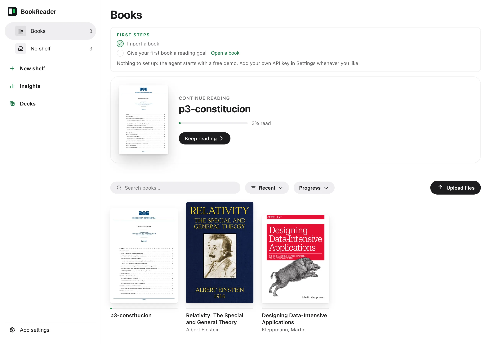

# Organise your library

The library is the home screen: shelves on the left, books on the right. With a few books it hardly
matters; with fifty, the difference between finding something and not finding it is how you organise
it.

<figure markdown>
  
  <figcaption>Shelves on the left, books on the right. Search and the status filter live on top.</figcaption>
</figure>

## Two kinds of shelves

- **Manual.** You choose what goes in. **New shelf** creates one; you can nest them (for example
  `Technical/Agents`) and drag a book onto a shelf on desktop.
- **Smart.** They fill themselves from a rule: status (not started, reading, finished), format,
  author, title, age, or membership of another shelf. **New smart shelf** lets you combine
  conditions. A book can be on several at once.

At the top you have the search box (**Search book…**) and the status filter. Search looks at title
and author; status is picked from the dropdown.

!!! tip "Unshelved is not lost"
    Smart shelves by status cover **every** book. A book that is not on any manual shelf only means
    you have not filed it: it is still in the library and on its status shelf.

## The book's details

Open a book's menu (the three dots) to:

- **Edit title and author**, if the download came with junk in the metadata.
- Change the **status**: not started, reading, finished.
- **Share book**: on a phone it opens the system sheet to send it to Kindle, email or AirDrop; on
  desktop it downloads the file. It can also be shared with your notes.
- **Export file**, to get the original EPUB or PDF out.
- **Download** the file if it lives in Drive or on another device.

Editing the details does not touch the book: the file and your notes stay as they are.

## Sharing books and shelves

You hand someone a book or a shelf **together with what you made of it**: what gets shared is a
dossier, not just a list of books.

**What you can send.** From the shelf menu, **Share shelf…**; from the book's menu or the reader's
“More”, **Share book**. Before sending you pick what to include:

- **The books** (PDF/EPUB), with their size shown up front — if a book has no file on this device
  (Drive only), it cannot travel in the package.
- Highlights and notes, notebooks, and agent conversations (optional: check first whether you want
  the chat to travel).
- Studio artifacts (summaries, mind maps, infographics) and card decks (without your progress).

**Two ways:**

- **Link**: encrypted on your device, opens with a tap, **expires in 7 days**. You can withdraw it
  earlier from the same menu (or in Settings → Data → “Shared links”). The cap is **100 MB** per
  link; if it doesn't fit, the app offers to send it as a file.
- **A `.bookreader` file**: for those who'd rather nothing pass through a server (even though the
  link is encrypted) or have no connection.

Whoever receives the link or file sees what it carries and from whom, picks which books to import,
and the notes anchor to that book in their library. Remember the package carries your notes for
those books: send it only to someone who should see them.

## Insights: what you actually read

**Insights** (in the library sidebar) counts reading time at a human pace: flipping pages to find
something or leaving the book open adds nothing. You can look by day, week, month or year, by book or
by shelf, and see:

- Time read and words per minute.
- Progress and days to finish.
- Reviews, true retention and check-in questions on chapters read two weeks ago or more.
- The load ahead, and the option to **pause new cards** if it piles up.

## The algorithm, tuned to your memory

With enough history (from about **400 reviews** on), Insights offers to **train the scheduling
algorithm on your data**: FSRS ships default parameters that already work well, but your history
can tune them to how you forget. It is never applied on its own:

1. It trains on your device and shows you the comparison — prediction error and next month's
   workload, with default parameters versus yours.
2. **You decide**: if it doesn't improve, it isn't even offered; you can reject it.
3. If you accept, it travels with sync to your other devices, and there is always a button to go
   back to the defaults.

## A book's history

With the scope set to **one book**, "all" stops being a calendar and becomes the book's full
story: when you started it, how many days it took, at what real pace, and the page-by-page
**progress curve**. It is the view that answers "did I make the most of this book, or did I drag
it?".

## Next step

- [Read offline](read-offline.md).
- [Sync and back up](sync-and-backup.md).

