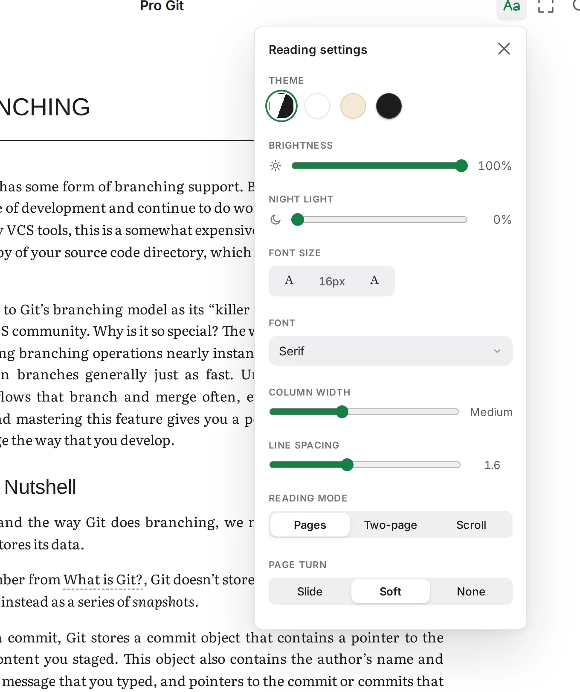

# Read a book

BookReader is a reader before anything else. This is what you have while reading and how to make it
yours; every setting is saved and applies to all your books.

## Open and get your bearings

Open the book from the shelf. Top left you have **‹ Library** (back to the shelf without closing the
book) and the **contents and notes** button. Top right:

- **Aa** opens **reading settings**: type, theme and mode.
- **Full screen** hides the bars (immersive reading).
- **Search** jumps to search inside the book.
- **Bookmark page** marks where you are.
- **…** opens the rest: app settings and library.
- **✦** opens or closes the agent.

The side panel has four tabs: **Contents** (the table of contents), **Search**, **Bookmarks** and
**Highlights**. You do not need to select anything to ask the agent.

## The table of contents knows where you are

Each entry shows its page and the section you are in is marked. Books with several levels expand.
Tapping an entry jumps to the passage, including in scroll mode.

!!! warning "A PDF with no table of contents"
    A PDF's table of contents comes from its **bookmarks**. If it was generated without them, it
    still reads fine but the sidebar is empty. Not a BookReader bug.

## Three ways to turn the page

- **Pages**: one page at a time, like paper.
- **Spread**: two pages, if the screen allows.
- **Scroll**: one continuous strip; handy for PDFs and for thumb-reading on a phone.

**Immersive reading** hides the bars so only text remains; they come back when you tap the screen or
move the mouse. Press Esc to leave.

## Type and paper

In **Reading settings**:

<figure markdown>
  
  <figcaption>Settings apply over the page, without closing the book: you see the change in the real text.</figcaption>
</figure>

| Setting                    | What it does                                                                  |
| -------------------------- | ----------------------------------------------------------------------------- |
| Font and size              | The EPUB text. Not in PDF: the layout is printed and you adjust it with zoom. |
| Column width               | A narrow column is easier on the eyes on wide screens.                        |
| Line spacing               | Air between lines.                                                            |
| Theme                      | Auto (follows the system), Light, Sepia and Dark.                             |
| Brightness and night light | Lowers the white at night without inverting colours.                          |
| Fit (PDF)                  | Page, Width or Text. "Text" trims the white margins.                          |

In PDFs you can also tint the paper: Grey or Night. Night inverts the ink, so photos and colour
figures may look odd.

## Time and progress

The book saves your progress and tells you how much is left: per chapter and per book, in reading
time, not pages. The figure uses your real pace, so it ignores skimming.

## Bookmarks, highlights and notes

- **Bookmark**: marks a page in the bookmark list.
- **Select text** to highlight it, add a note, copy it, share it or ask the agent. Explained in
  [Ask the book](ask-the-book.md).

## Shortcuts and gestures

The full table of keyboard shortcuts and gestures lives in the reference:
[Keyboard shortcuts and gestures](../referencia/keyboard-shortcuts.md).

## Next step

- [Ask the book](ask-the-book.md).
- [Turn reading into review](turn-reading-into-review.md).

