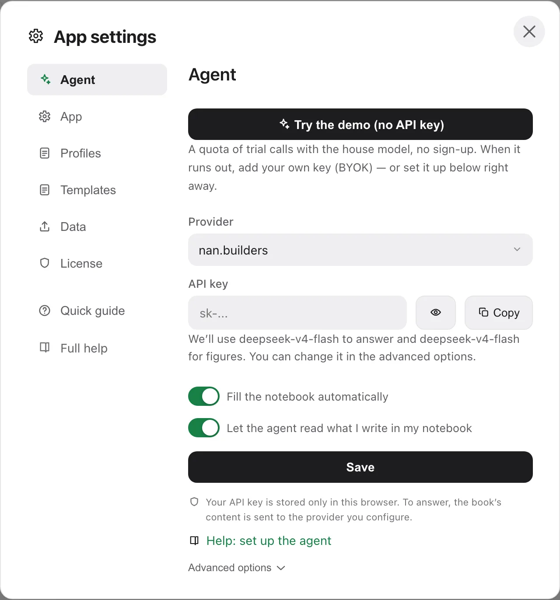

# Set up the agent

The agent is what turns the reader into something that answers. You have two paths and you can
switch whenever you like: **the free demo** or **your own key**.

<figure markdown>
  
  <figcaption>Everything about the agent lives in Settings → Agent: demo, provider, key.</figcaption>
</figure>

## Path 1: the demo (zero setup)

The first time you ask for something, BookReader gives you a **free demo**: a quota of questions to
try the agent with no account and no key. Nothing to switch on; if you want to see it or start it
again:

1. Open **Settings** (the gear).
2. Go to **Agent**.
3. Press **Try the demo**.

When it runs out, the app tells you and offers to add your key. The demo is for trying; for serious
reading, use your key.

!!! note "The demo goes through our gateway"
    To give you a demo without a key, the request goes through a service of ours that talks to the
    model. With your key, the browser talks **straight** to your provider.

## Path 2: your key (BYOK)

Bring your own key: you use your account with an AI provider and pay that provider for what you
use. BookReader does not charge for the agent.

1. Open **Settings → Agent**.
2. Pick a **Provider**. There are presets for `nan.builders`, **OpenAI**, **OpenRouter** and
   **Groq**. With **Custom**, any OpenAI-compatible service works (a local model, a company
   gateway…).
3. Paste your **API key**.
4. Pick the **model**. If your provider is not in the list, type its id or refresh the catalogue.
5. Save. The key stays **on this device**; it is not in the backup or in sync.

!!! tip "Vision and dictation models"
    To explain a figure or review a sketch, the model must accept images. To dictate with your
    provider instead of the browser, configure a transcription model. Both are optional settings in
    the same section.

## What changes with each path

|         | Demo                                 | Your key                                   |
| ------- | ------------------------------------ | ------------------------------------------ |
| Setup   | None                                 | Provider, key and model                    |
| Cost    | Free, within a quota                 | Whatever your provider charges             |
| Privacy | The request goes through our gateway | The browser talks straight to the provider |
| Limit   | It runs out                          | Your account's limit                       |
| Model   | The one the demo serves              | The one you choose                         |

## If the agent does not answer

- **"API key missing" or "Invalid API key"**: check that you pasted the whole key and that it
  belongs to the selected provider.
- **The demo ran out**: add your key in **Settings → Agent** and carry on where you were.
- **The model does not respond or is slow**: try another model from the same provider; long
  reasoning models take longer.
- **It does not understand a figure**: you need a vision model.

## Next step

- [Ask the book](ask-the-book.md).
- [How the agent answers](../explicacion/how-the-agent-works.md), if you want to know what it does
  with what you send it.

