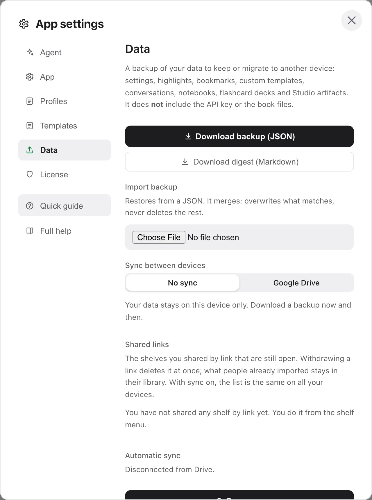

# Sync and back up

Your books live on this device. To have them on another, or to avoid losing them when you clear the
browser, there are two different things and it pays not to mix them up: **syncing** and **backing
up**.

## Sync: the same data on several devices

There are two ways today:

- **Google Drive** (free, available now). Your data goes to a private folder in **your** Drive. The
  only server of ours involved renews Google's permission; books and notes go from the browser to
  your Drive. That folder belongs to the app (`appDataFolder`) and **is not visible in
  drive.google.com**: do not look for it in Drive's interface.
- **BookReader Sync** (included in Plus, **coming soon**). No Drive to configure and end-to-end
  encryption from the device. Not open yet: if you see it in Settings, it is in testing.

### Turn on Google Drive

<figure markdown>
  
  <figcaption>Everything about backups and sync lives in Settings → Data.</figcaption>
</figure>

1. **Settings → Data**.
2. Under **Sync between devices**, pick **Google Drive**.
3. **Connect Google Drive** and authorise.
4. Decide whether to **sync book files too**. Without this, the other device shows the details and
   notes, but you must download the book to read it.
5. **Save to Drive**.

From then on sync is automatic. The same panel has **Restore from Drive**, **Version history** and
the space left.

!!! warning "Over 50 MB"
    A book over 50 MB is not uploaded automatically. You request it from the book menu on the other
    device.

## Backup: one file with everything of yours

**Settings → Data → Download backup (JSON)**. It includes settings, highlights, bookmarks, custom
templates, conversations, notebooks, decks, exercises and Studio artifacts.

It **does not include** the API key or the book files. The key stays on the device on purpose: a
backup you share should not carry your credentials.

**Import backup** merges: it overwrites what matches and does not delete what is left over. Restoring
an old backup does not remove what you did afterwards.

## If something disappears

Do not touch anything yet, and in this order:

1. **Download a backup** before anything else.
2. **Look in the other browser, profile or origin.** Browser storage is per browser and per
   profile; two copies of the app can hold different libraries.
3. **Do not press "Clean orphan entries".** It is meant for records without a file, and in the
   middle of a scare it is easy to make things worse.
4. If the book is in Drive, check the sync panel's **Version history**: it keeps copies of the book
   file.
5. If none of that explains it, write to me before uploading anything again: **re-uploading a
   different file creates a new book** and does not recover the old annotations.

BookReader has no telemetry: there is no central record of your library to look at. What exists, and
what a diagnosis uses, is what stays on your device and in your Drive.

## Next step

- [Connect an AI agent](connect-an-agent.md), if you have Plus.
- [What happens to your data](../explicacion/your-data.md).
- [Sync and storage](../referencia/sync-and-storage.md), if you are after a ceiling or a number.

