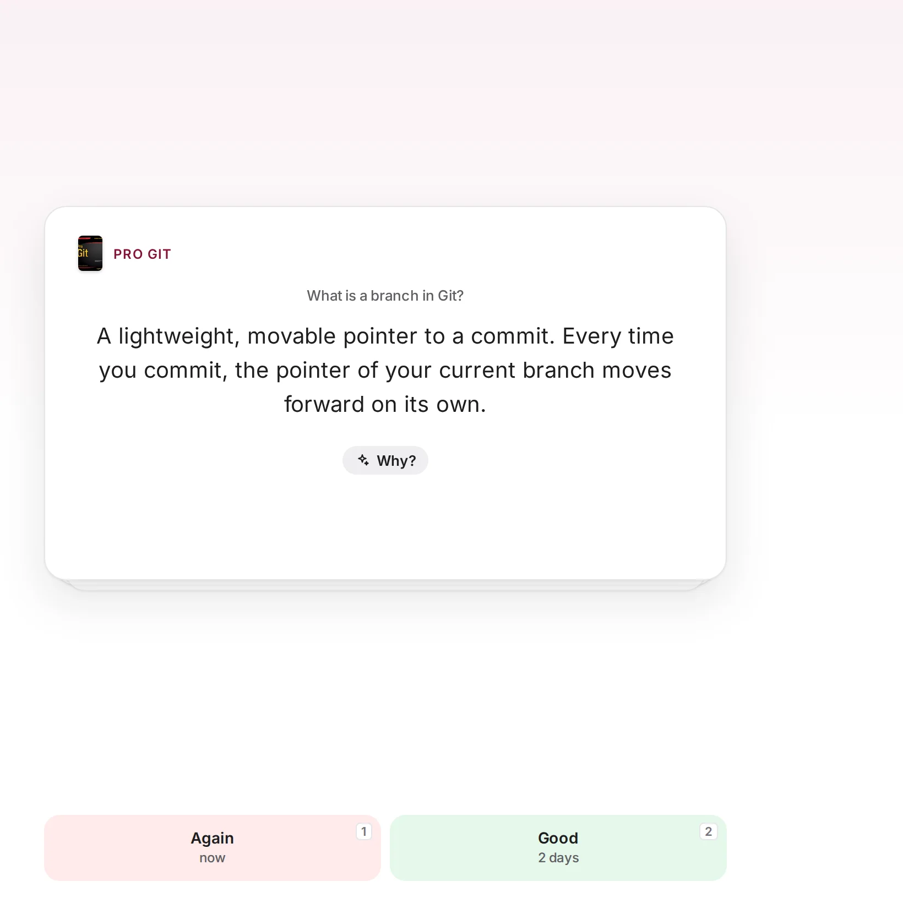

# Turn reading into review

Reading is not remembering. BookReader turns the book into **cards** that come back just before you
forget them, into **notes** you can read at a glance, and lets you take it all to Anki if that is
where you live.

## The Studio: summary, mind map and infographic

Next to the cards, the book's Studio produces three notes that stay with you: they are **cached
per book**, so you generate once and consult forever — offline, after the first time.

- **Summary**: a TL;DR and key ideas per chapter, each with its citation to the passage.
- **Mind map**: a navigable, branching map of the book's concepts; branches expand and the map
  grows on itself.
- **Infographic**: a poster of the book —thesis, key ideas and a quote— ready to download.

All three are heavy jobs: they run **in the background** (you will see a progress chip; you can
close the panel and keep reading) and if one fails, you retry it from the Studio itself.

The Studio also has **Explain it yourself**: it doesn't produce a note, it sets up an exercise in
which you explain a concept and the agent questions you until you build it —
[Feynman mode](ask-the-book.md#feynman-mode-you-explain-it).

## Where the cards come from

1. **From the book's Studio.** Open the book, open the agent and go to the **Studio** tab. Ask for
   **Flashcards** for a chapter, a selection or the whole book. The agent reads the text and
   proposes the cards.
2. **From a selection.** Select a passage and send it to the notebook or create a card with its
   quote: the card keeps pointing at the exact page.
3. **From a deck you already have.** In the library, **Decks** gathers every card deck, whether or
   not it is tied to a book.

<figure>
  
  <figcaption>The book's Studio: summaries, mind maps, infographics and cards come from here.</figcaption>
</figure>

Before studying, review: you can edit the front, the back and the options. A bad card costs more
than no card.

## Reviewing

In **Decks** you see what is due today. Review uses **FSRS**, the same kind of algorithm as Anki:

- Each card comes back when the algorithm predicts you are about to forget it.
- You grade with **two buttons** (Again · Good) or **four** (Again · Hard · Good · Easy). Two is
  faster and the algorithm works just as well.
- The **new-card limit** stops a freshly generated deck from dropping 90 cards on you on day one.
  Cards you have already started always come in.
- The **streak** counts the days you review; the "due today" counter says what is left.
- To review **one topic**, pick its shelf in the library and tap **Review · N** in its header:
  only the cards from its books come in. The green dot in the shelf list tells you which ones have
  work today.

!!! note "The percentage is not a thermometer"
    FSRS schedules each review when it predicts you will be right about 90 % of the time. That
    percentage tends to 90 % by construction; what changes as you learn is the **interval**, not the
    number. The [explanation](../explicacion/how-the-agent-works.md) says it without decoration.

<figure markdown>
  
  <figcaption>A card from today's review: the answer in front and two buttons; FSRS decides when it returns.</figcaption>
</figure>

## Study mode

**Study** opens the full-screen session. There are two doors in: from one specific deck, or
**Study everything**, the daily queue with everything due across all your decks.

Inside, it is not all flipping a card:

- **Cloze**: you type the missing part of the sentence and it is checked literally.
- **Multiple choice**: shuffled options (answerable with keys 1–4).
- **Figures**: the book's diagram arrives with the answer hidden; uncover it and correct yourself.
- **Sketch**: for what you learn by drawing — paint the answer on the canvas and the agent reviews
  it with vision, rubric step by step, stroke by stroke.
- **Why?**: with the card flipped, one-tap questions —Give me an example · What does it rule out? ·
  Why does it matter?— and the agent answers with the book's passage in front of it.

And what surrounds the session:

- **Daily goal**: you pick how many cards a day and the header ring counts them; the streak warns
  you when it is at risk, before it is lost.
- **Undo**: mis-graded a card, one Z key (or the button) brings it back.
- **Chapter gate**: new cards from chapters you haven't read yet stay out; no accidental spoilers.
- State is saved **after every card**: close mid-session and nothing is lost.

The grading buttons (two or four) and the new-card limit live in **Settings → Application**.

## Exercises, in addition to cards

The Studio can also build a practice **matrix**: rows and columns to fill in by comparing concepts,
with citations. It covers what a card cannot: relating ideas, not recalling a single fact. Exercises
live apart from cards and do not count as spaced review.

## Taking it to Anki

In the deck, **Export .apkg** builds an Anki deck with your cards. There is also a text export for
anyone who prefers to import by hand. Cards keep their page, so in Anki they still point at the book.

## What it does not do

- It does not invent cards for what is not in the text.
- It does not send your cards to a server: they stay on your device (and in your Drive, if sync is
  on).
- It does not replace reading. If a card does not ring a bell, go back to the passage: the link is
  on the card.

## Next step

- [Organise your library](organise-your-library.md).
- [Sync and back up](sync-and-backup.md) so you do not lose your progress.

