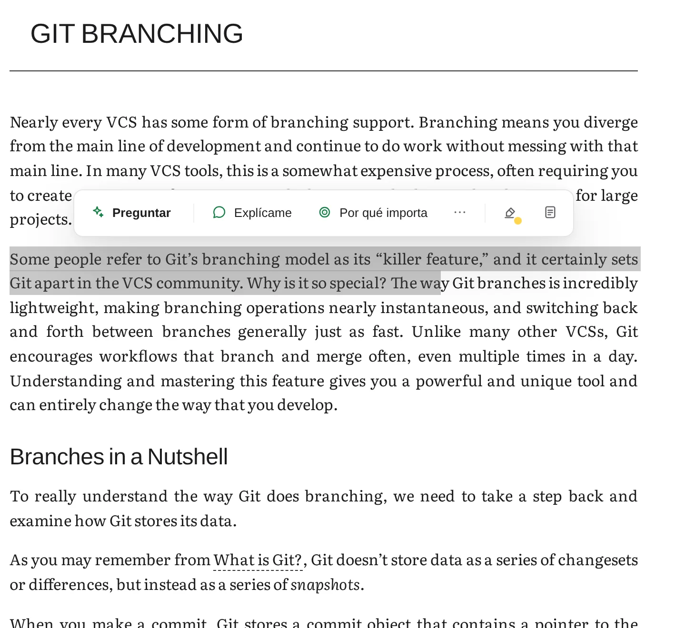

# Pregúntale al libro

El agente responde **con el libro delante**: busca el pasaje que toca, te lo enseña y escribe la
respuesta citándolo. No busca en internet y no inventa fuentes; si algo no está en el libro, lo
dice.

## La forma rápida: selecciona y elige

Selecciona un texto y aparece la barra de acciones. Las de arriba son las preguntas de siempre:

<figure markdown>
  
  <figcaption>Selecciona y elige: la barra lleva las preguntas de siempre y, en «…», el resto y el subrayado.</figcaption>
</figure>

| Acción                     | Qué hace                                                         |
| -------------------------- | ---------------------------------------------------------------- |
| **Explícame**              | Te lo cuenta en llano, con un ejemplo concreto.                  |
| **Por qué importa**        | Lo conecta con tu objetivo de lectura.                           |
| **Qué significa aquí**     | La definición tal y como la usa el autor, no la del diccionario. |
| **Dónde más lo trata**     | Busca el mismo asunto en otro capítulo.                          |
| **La objeción más fuerte** | Argumenta en contra: útil para leer con criterio.                |
| **Con números**            | Cambia el ejemplo a algo medible, si el libro da datos.          |

En la misma barra puedes **subrayar** de un toque (con el último color), añadir una **nota**,
**copiar**, **compartir** una tarjeta-cita, **mandar el fragmento a la libreta** o **empezar a
escribir** tu propia pregunta con el pasaje adjunto.

!!! tip "Dos piden objetivo"
    **Por qué importa** y **Con números** necesitan un **objetivo de lectura**. Si no lo has
    elegido, la app te lo pide: es lo que convierte la respuesta en algo tuyo y no en un resumen
    genérico.

## Preguntar a mano

Abre el agente con **✦** (o con `]`) y escribe. Puedes:

- Preguntar por el capítulo que estás leyendo o por el libro entero.
- Elegir **objetivo de lectura** y **plantilla de libreta** para esa conversación.
- Pedir que te responda en tu idioma aunque el libro esté en otro: busca en el original y contesta
  en el tuyo, citando el pasaje original.
- Adjuntar una **figura o ecuación** (PDF): selecciona una zona y mándala con la pregunta.

## Citas: la respuesta se comprueba

Debajo de cada respuesta hay citas con su capítulo y su página. Al tocar una, el lector salta al
pasaje. Es la diferencia entre «el agente dice» y «el libro dice»: si la cita no sostiene la
respuesta, tienes delante el sitio para comprobarlo.

<figure>
  
  <figcaption>Cada respuesta trae su cita y su página. El pasaje original está a un toque.</figcaption>
</figure>

## Modo Feynman: explícalo tú

En vez de preguntar, explica tú el concepto y el agente hace de contrapunto: te dice qué falta, qué
está flojo y qué has acertado, sin darte la respuesta antes de tiempo. Se abre desde el menú del
agente.

## La pregunta al terminar un capítulo

Con la plantilla **HQ&A** activa, al empezar un capítulo nuevo el agente te hace **una pregunta de
recuerdo** sobre el anterior. No da la respuesta: es un control de que lo leído se ha quedado. Solo
pregunta hacia delante y una vez por capítulo.

## Si la respuesta no te sirve

- **«No encuentro eso en este libro»**: el término no aparece tal cual. Prueba con las palabras
  del autor, o pide **Dónde más lo trata**.
- **Cita un pasaje y la respuesta se va por las ramas**: haz la pregunta más pequeña. El agente
  responde mejor a «qué dice aquí sobre X» que a «resúmeme el capítulo».
- **No hay agente**: mira [Configura el agente](set-up-ai-key.md).

## Siguiente paso

- [Convierte lo leído en repaso](turn-reading-into-review.md).
- [Cómo responde el agente](../explicacion/how-the-agent-works.md), con sus límites.

---

_Actualizado el 15 de noviembre de 2026._
