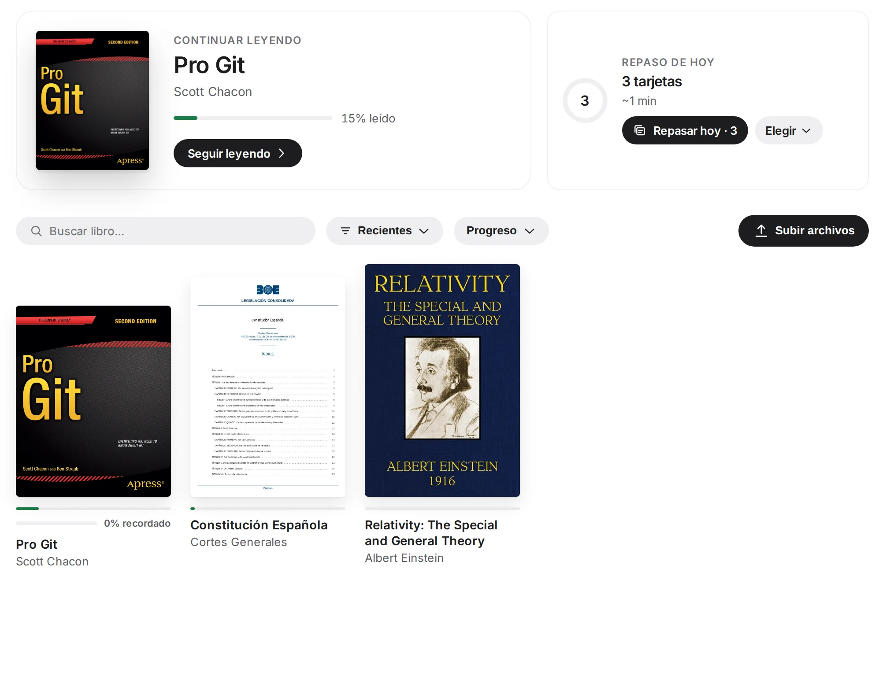

# Sube un libro

BookReader lee **EPUB y PDF sin DRM**. No hay cuenta ni servidor de libros: el fichero se queda en
el almacenamiento de tu navegador, en este dispositivo. Si quieres tenerlo en otro, se sincroniza
después (o se vuelve a subir).

<figure markdown>
  
  <figcaption>La biblioteca: los libros, lo que estás leyendo y el repaso que toca hoy.</figcaption>
</figure>

## Antes de empezar

- Un **EPUB** o un **PDF** que puedas abrir sin la app de Amazon o de Adobe. Si tu libro solo se
  abre en Kindle, tiene DRM y BookReader no puede leerlo.
- Un PDF **escaneado** (una foto de cada página) se ve, pero no tiene texto: el agente no puede
  buscar dentro ni citar pasajes. Para leerlo, vale; para preguntarle, no.

## Tres formas de meterlo

1. **Desde la biblioteca.** Abre la estantería y pulsa **Subir archivos**. También puedes
   arrastrar el fichero a la ventana.
2. **Desde el móvil.** Abre el menú de compartir del fichero y elige **BookReader** (Android). En
   iOS, guárdalo en Archivos y ábrelo desde **Subir archivos**.
3. **Con doble clic** (Chrome de escritorio, app instalada): los `.epub` y `.pdf` se abren con
   BookReader.

!!! tip "¿Muchos a la vez?"
    Puedes seleccionar varios ficheros en el diálogo de subida. Entran todos a la cola.

## Qué pasa después

El libro aparece en la biblioteca con su portada (si el fichero la trae) y su tamaño. Al abrirlo:

- El **índice** sale del propio libro: en EPUB, de su tabla de contenidos; en PDF, de sus
  **marcadores**. Un PDF sin marcadores se lee bien, pero el índice sale vacío: no es un fallo de
  la subida. Lo explica [Formatos y límites](../referencia/formats-and-limits.md).
- El **texto** se prepara para buscar y para el agente. En un libro grande puede tardar unos
  segundos la primera vez.
- El progreso de lectura empieza en cero y se guarda solo.

## Si algo no va

| Síntoma                                   | Qué mirar                                                                                            |
| ----------------------------------------- | ---------------------------------------------------------------------------------------------------- |
| «Formato no soportado»                    | El fichero tiene DRM o es otro formato (MOBI, AZW3, CBZ). Solo EPUB, PDF o un dossier `.bookreader`. |
| Se abre sin índice                        | El PDF no trae marcadores. Se puede leer igual.                                                      |
| Se abre, pero el agente no encuentra nada | Es un PDF escaneado, sin texto.                                                                      |
| No aparece la portada                     | El EPUB no la declara; se puede seguir leyendo.                                                      |

## Siguiente paso

- [Configura el agente](set-up-ai-key.md) para preguntarle al libro.
- [Lee un libro](read-a-book.md) para dejarlo a tu gusto.

---

_Actualizado el 15 de noviembre de 2026._
