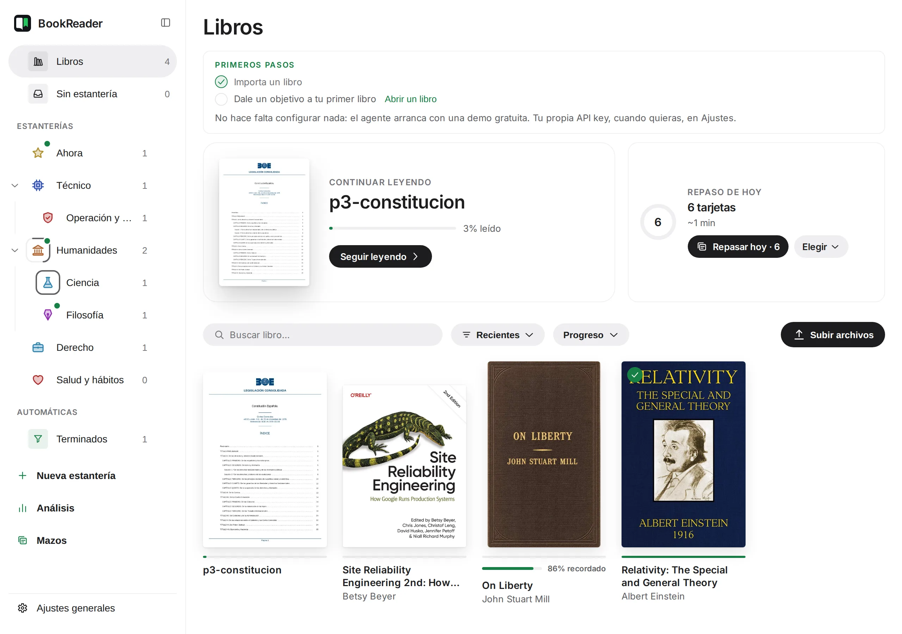

# Ordena tu biblioteca

La biblioteca es la pantalla de inicio: estanterías a la izquierda, libros a la derecha. Con pocos
libros da igual; con cincuenta, la diferencia entre encontrar algo y no encontrarlo está en cómo la
ordenas.

<figure markdown>
  
  <figcaption>Estanterías a la izquierda, libros a la derecha. El buscador y el filtro de estado, arriba.</figcaption>
</figure>

## Estanterías: dos tipos

- **Manuales.** Tú eliges qué va dentro. **Nueva estantería** crea una; puedes anidarlas (por
  ejemplo, `Técnico/Agentes`) y arrastrar un libro a una estantería en el escritorio.
- **Inteligentes.** Se llenan solas con una regla: estado (sin empezar, leyendo, terminados),
  formato, autor, título, antigüedad o pertenencia a otra estantería. **Nueva estantería
  inteligente** te deja combinar condiciones. Un libro puede estar en varias a la vez.

Arriba tienes el buscador (**Buscar libro…**) y el filtro por estado. La búsqueda mira el título y
el autor; el estado se elige en el desplegable.

!!! tip "«Sin estantería» no es «perdido»"
    Las estanterías inteligentes por estado cubren **todos** los libros. Que un libro no esté en
    ninguna estantería manual solo significa que no lo has clasificado: sigue en la biblioteca y en
    su estantería de estado.

## La ficha del libro

Abre el menú de un libro (los tres puntos) para:

- **Editar título y autor**, si la descarga venía con basura en la ficha.
- Cambiar el **estado**: sin empezar, leyendo, terminado.
- **Compartir libro**: en el móvil abre la hoja del sistema para mandarlo a Kindle, correo o
  AirDrop; en el escritorio descarga el fichero. También puede compartirse con tus notas.
- **Exportar archivo**, para sacar el EPUB o el PDF original.
- **Descargar** el fichero si está en Drive o en otro dispositivo.

La ficha no cambia el libro: editarla no toca el fichero ni pierde tus notas.

## Compartir libros y estanterías

Le pasas a otra persona un libro o una estantería **con lo que has sacado de ellos**: se comparte
un dossier, no solo la lista de libros.

**Qué se puede mandar.** Desde el menú de la estantería, **Compartir estantería…**; desde el menú
del libro o el «Más» del lector, **Compartir libro**. Antes de mandar eliges qué incluir:

- **Los libros** (PDF/EPUB), con el tamaño que pesan a la vista — si un libro está sin fichero en
  este dispositivo (solo en Drive), no puede viajar en el paquete.
- Subrayados y notas, libretas, y conversaciones con el agente (opcional: revisa antes si quieres
  que viaje el chat).
- Artefactos del Studio (resúmenes, mapas, infografías) y mazos de tarjetas (sin tu progreso).

**Dos vías:**

- **Enlace**: se cifra en tu dispositivo, se abre con un toque y **caduca en 7 días**. Puedes
  retirarlo antes desde el mismo menú (o en Ajustes → Datos → «Enlaces compartidos»). El tope es
  de **100 MB** por enlace; si no cabe, la app te ofrece mandarlo como fichero.
- **Fichero `.bookreader`**: para quien prefiera que nada pase por un servidor (aunque el enlace
  va cifrado) o no tenga red.

Quien recibe el enlace o el fichero ve qué trae y de quién, elige qué libros importar y las notas
quedan ancladas a su libro en su biblioteca. Piensa que el paquete lleva tus notas de esos libros:
mándalo solo a quien deba verlas.

## Análisis: lo que leíste de verdad

**Análisis** (en la barra lateral de la biblioteca) cuenta el tiempo de lectura a ritmo humano:
pasar páginas buscando algo o dejar el libro abierto no suma. Puedes mirar por día, semana, mes o
año, por libro o por estantería, y ver:

- Tiempo leído y palabras por minuto.
- Avance y días hasta terminar.
- Repasos, retención real y preguntas de comprobación de capítulos leídos hace dos semanas o más.
- La carga que viene, y la opción de **pausar las tarjetas nuevas** si se acumula.

## El algoritmo, ajustado a tu memoria

Con historia suficiente (a partir de unos **400 repasos**), Análisis te ofrece **entrenar el
algoritmo de repaso con tus datos**: FSRS trae parámetros de serie que ya funcionan bien, pero con
tu historial pueden afinarse a cómo olvidas tú. No se aplica solo:

1. Se entrena en tu dispositivo y te enseña la comparación — el error de predicción y la carga del
   próximo mes, con los parámetros de serie y con los tuyos.
2. **Tú decides**: si no mejora, ni se ofrece; puedes rechazarlo.
3. Si aceptas, viaja con el sync a tus otros dispositivos, y siempre hay botón para volver a los de
   serie.

## La historia de un libro

Con el ámbito fijado a **un libro**, «todo» deja de ser un calendario y es la historia completa del
libro: cuándo lo empezaste, cuántos días te llevó, a qué ritmo real y la **curva de avance**
página a página. Es la vista para responder «¿este libro lo aproveché o lo arrastré?».

## Siguiente paso

- [Lee sin conexión](read-offline.md).
- [Sincroniza y guarda una copia](sync-and-backup.md).

