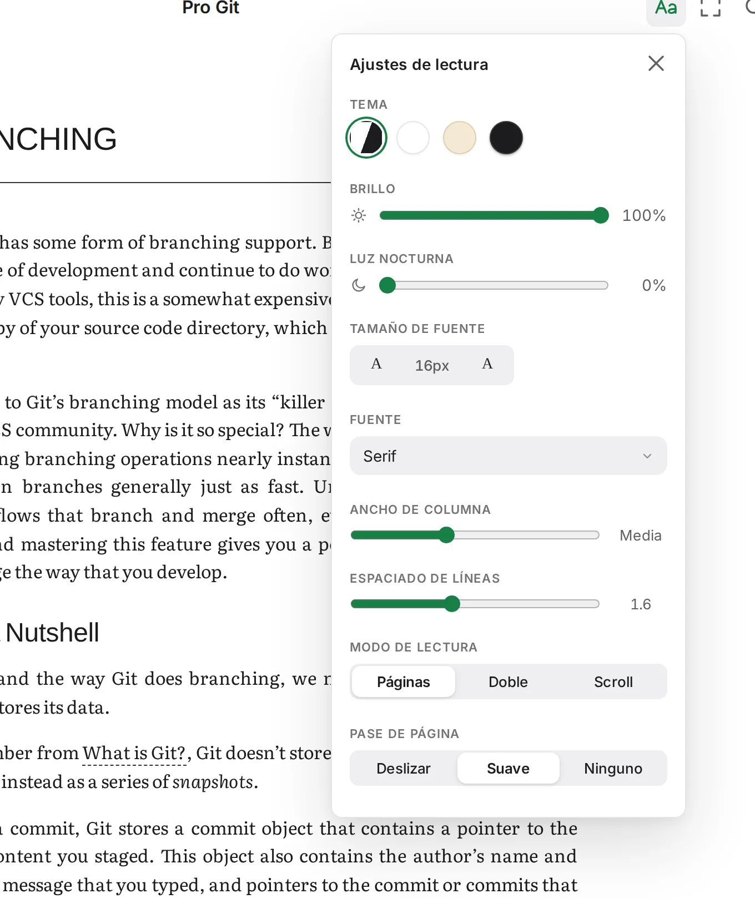

# Lee un libro

BookReader es un lector, antes que nada. Esto es lo que hay mientras lees y cómo dejarlo a tu
gusto; cada ajuste se guarda y se aplica a todos tus libros.

## Abrir y orientarte

Abre el libro desde la estantería. Arriba a la izquierda tienes **‹ Biblioteca** (vuelve a la
estantería sin cerrar el libro) y el botón del **índice y las notas**. Arriba a la derecha:

- **Aa** abre los **ajustes de lectura**: tipografía, tema y modo.
- **Pantalla completa** esconde las barras (lectura inmersiva).
- **Buscar** salta al buscador del libro.
- **Marcar página** deja un marcador donde estás.
- **…** abre el resto: ajustes generales y biblioteca.
- **✦** abre o cierra el agente.

El panel lateral tiene cuatro pestañas: **Contenido** (el índice), **Buscar**, **Marcadores** y
**Subrayados**. No hace falta seleccionar nada para preguntarle al agente.

## El índice dice dónde estás

En el índice, cada entrada lleva su página y la sección en la que estás queda marcada. Si el libro
tiene varios niveles, se despliegan. Tocar una entrada salta al pasaje, también en modo scroll.

!!! warning "Un PDF sin índice"
    El índice de un PDF sale de sus **marcadores**. Si el PDF se generó sin ellos, se lee igual,
    pero el índice sale vacío. No es un fallo de BookReader.

## Tres formas de pasar página

- **Páginas**: una página a la vez, como un libro de papel.
- **Doble**: dos páginas, si la pantalla da de sí.
- **Scroll**: una tira continua; útil para PDF y para leer en el móvil con el pulgar.

La **lectura inmersiva** esconde las barras para que solo quede el texto; vuelven al tocar la
pantalla o al mover el ratón. Se sale con Esc.

## Tipografía y papel

En **Ajustes de lectura**:

<figure markdown>
  
  <figcaption>Los ajustes se aplican sobre la página, sin cerrar el libro: ves el cambio en el texto real.</figcaption>
</figure>

| Ajuste              | Para qué                                                                         |
| ------------------- | -------------------------------------------------------------------------------- |
| Fuente y tamaño     | El texto del EPUB. En PDF no hay: la maqueta viene impresa y se ajusta con zoom. |
| Ancho de columna    | Una columna estrecha cansa menos la vista en pantallas anchas.                   |
| Espaciado de líneas | Aire entre líneas.                                                               |
| Tema                | Auto (sigue al sistema), Claro, Sepia y Oscuro.                                  |
| Brillo y luz cálida | Baja el blanco de noche sin invertir los colores.                                |
| Ajuste (PDF)        | Página, Ancho o Texto. «Texto» recorta los márgenes blancos.                     |

En PDF también puedes teñir el papel: Gris o Noche. En Noche se invierte la tinta, así que las
fotos y las figuras en color pueden verse raras.

## Tiempo y progreso

El libro guarda tu progreso y te dice cuánto te queda: por capítulo y por libro, en tiempo de
lectura, no en páginas. La cifra se calcula con tu ritmo real, así que no cuenta los saltos.

## Marcadores, subrayados y notas

- **Marcador**: deja una página señalada en la lista de marcadores.
- **Selecciona texto** para subrayarlo, ponerle una nota, copiarlo, compartirlo o preguntarle al
  agente. Está explicado en [Pregúntale al libro](ask-the-book.md).

## Atajos y gestos

La tabla completa de atajos de teclado y gestos está en la referencia:
[Atajos y gestos](../referencia/keyboard-shortcuts.md).

## Siguiente paso

- [Pregúntale al libro](ask-the-book.md).
- [Convierte lo leído en repaso](turn-reading-into-review.md).

