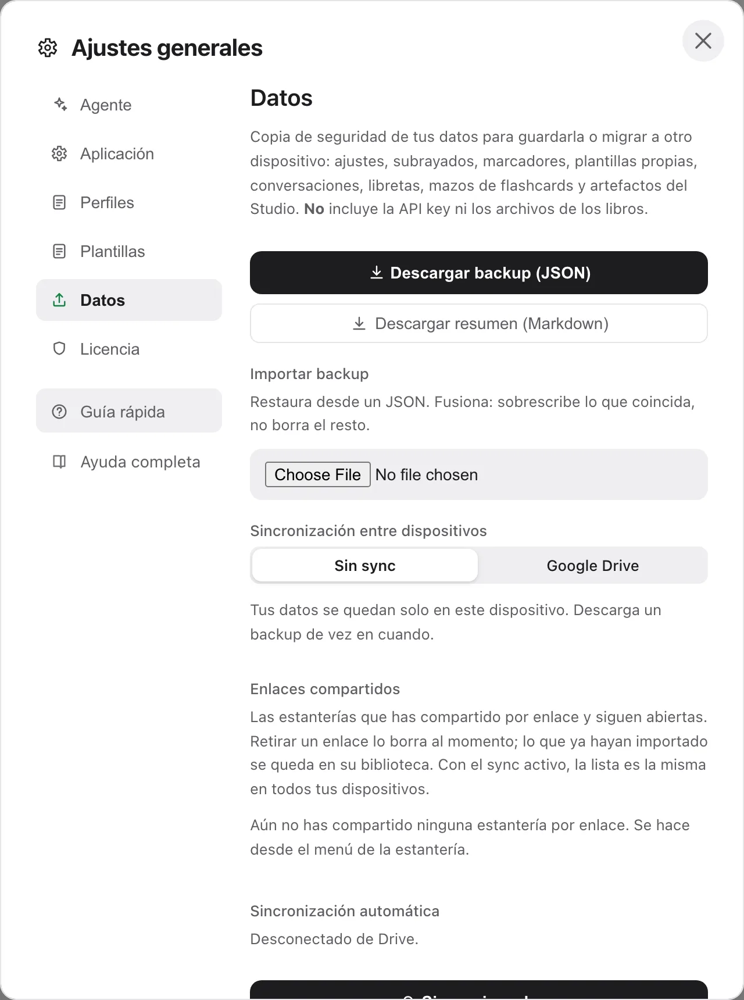

# Sincroniza y guarda una copia

Tus libros viven en este dispositivo. Para tenerlos en otro, o para no perderlos si borras el
navegador, hay dos cosas distintas y conviene no confundirlas: **sincronizar** y **hacer un
backup**.

## Sincronizar: los mismos datos en varios dispositivos

Hoy hay dos formas:

- **Google Drive** (gratis, disponible ya). Tus datos van a una carpeta privada de **tu** Drive. El
  único servidor implicado es el que renueva el permiso de Google; los libros y las notas van del
  navegador a tu Drive. Esa carpeta es de la app (`appDataFolder`) y **no se ve en
  drive.google.com**: no la busques en la interfaz de Drive.
- **Sync de BookReader** (incluido en Plus, **muy pronto**). Sin configurar Drive y cifrado de
  extremo a extremo desde el dispositivo. Todavía no está abierto: si lo ves en Ajustes, está en
  pruebas.

### Activar Google Drive

<figure markdown>
  
  <figcaption>Todo lo de copias y sync vive en Ajustes → Datos.</figcaption>
</figure>

1. **Ajustes → Datos**.
2. En **Sincronización entre dispositivos**, elige **Google Drive**.
3. **Conectar con Google Drive** y autoriza.
4. Decide si quieres **sincronizar también los archivos de los libros**. Sin esto, en el otro
   dispositivo verás las fichas y las notas, pero tendrás que bajar el libro para leerlo.
5. **Guardar en Drive**.

A partir de ahí la sincronización es automática. En el mismo panel tienes **Restaurar desde Drive**,
**Historial de versiones** y el espacio que queda.

!!! warning "Más de 50 MB"
    Un libro de más de 50 MB no se sube solo. Se pide desde el menú del libro en el otro
    dispositivo.

## Backup: un fichero con todo lo tuyo

**Ajustes → Datos → Descargar backup (JSON)**. Incluye ajustes, subrayados, marcadores, plantillas
propias, conversaciones, libretas, mazos, ejercicios y artefactos del Studio.

**No incluye** la API key ni los archivos de los libros. La clave se queda en el dispositivo a
propósito: un backup que se comparte no debe llevarse tus credenciales.

**Importar backup** fusiona: sobrescribe lo que coincide y no borra lo que sobra. Restaurar un
backup viejo no elimina lo que hayas hecho después.

## Si algo desaparece

No toques nada todavía, y en este orden:

1. **Descarga un backup** antes de cualquier otra cosa.
2. **Mira el otro navegador, el otro perfil o el otro origen.** El almacenamiento del navegador es
   por navegador y por perfil; dos copias de la app pueden tener bibliotecas distintas.
3. **No pulses «Limpiar entradas huérfanas».** Está pensado para fichas sin fichero, y en medio de
   un susto es fácil empeorarlo.
4. Si el libro lo tienes en Drive, mira el **Historial de versiones** del panel de sync: guarda
   copias del fichero del libro.
5. Si nada de eso lo explica, escríbeme antes de volver a subir nada: **re-subir un fichero
   distinto crea un libro nuevo** y no recupera las anotaciones del anterior.

BookReader no tiene telemetría: no hay un registro central de tu biblioteca al que mirar. Lo que
hay, y es lo que se usa en el diagnóstico, es lo que queda en tu dispositivo y en tu Drive.

## Siguiente paso

- [Conecta un agente](connect-an-agent.md), si tienes Plus.
- [Qué pasa con tus datos](../explicacion/your-data.md).
- [Sync y almacenamiento](../referencia/sync-and-storage.md), si buscas un tope o un número.

