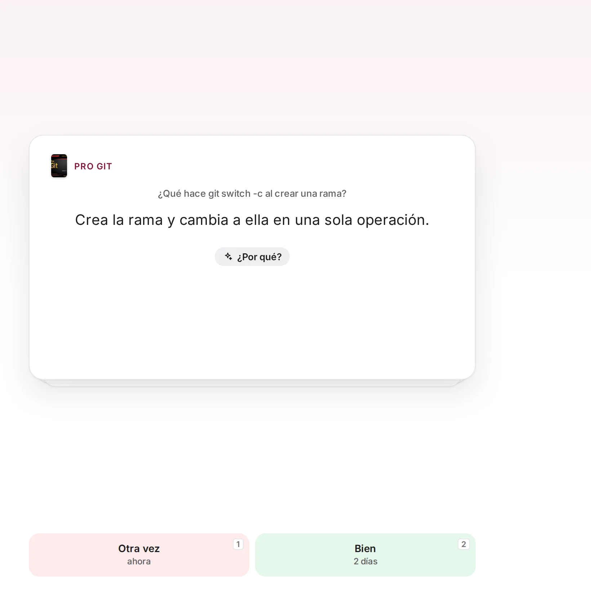

# Convierte lo leído en repaso

Leer no es recordar. BookReader convierte el libro en **tarjetas** que vuelven cuando estás a punto
de olvidarlas, en **apuntes** que se leen de un vistazo, y te deja llevártelo todo a Anki si ya
vives allí.

## El Studio: resumen, mapa mental e infografía

Junto a las tarjetas, el Studio del libro genera tres apuntes que se quedan contigo: se **cachean
por libro**, así que generas una vez y consultas siempre, sin conexión después de la primera vez.

- **Resumen**: TL;DR e ideas clave por capítulo, cada una con su cita al pasaje.
- **Mapa mental**: mapa por ramas navegable de los conceptos del libro; las ramas se abren y el
  mapa crece sobre sí.
- **Infografía**: un póster del libro —tesis, ideas clave y cita— listo para descargar.

Los tres son trabajos pesados: van en **segundo plano** (verás un chip con el progreso; puedes
cerrar el panel y seguir leyendo) y si alguno falla, se reintenta desde el propio Studio.

## De dónde salen las tarjetas

1. **Del Studio del libro.** Abre el libro, entra en el agente y ve a la pestaña **Studio**. Pide
   **Flashcards** para un capítulo, para una selección o para el libro entero. El agente lee el
   texto y propone las tarjetas.
2. **De una selección.** Selecciona un pasaje y mándalo a la libreta o créale una tarjeta con su
   cita: la tarjeta se queda apuntando a la página exacta.
3. **De un mazo que ya tienes.** En la biblioteca, **Mazos** reúne todos los mazos de tarjetas,
   estén o no ligados a un libro.

<figure>
  
  <figcaption>El Studio del libro: de aquí salen el resumen, el mapa, la infografía y las tarjetas.</figcaption>
</figure>

Antes de estudiar, revisa: puedes editar el frente, el dorso y las opciones. Una tarjeta mala
cuesta más que no tenerla.

## Repasar

En **Mazos** verás lo que toca hoy. El repaso usa **FSRS**, el mismo tipo de algoritmo que Anki:

- Cada tarjeta vuelve cuando el algoritmo calcula que estás a punto de olvidarla.
- Puntas con **dos botones** (Otra vez · Bien) o con **cuatro** (Otra vez · Difícil · Bien ·
  Fácil). Con dos se decide más rápido y el algoritmo funciona igual.
- El **tope de tarjetas nuevas** evita que un mazo recién generado te ponga 90 tarjetas el primer
  día. Las que ya llevas empezadas entran siempre.
- La **racha** cuenta los días que repasas; el contador de «para hoy» dice lo que queda.

!!! note "El porcentaje no es un termómetro"
    FSRS programa cada repaso cuando predice que acertarás en torno al 90 %. Ese porcentaje tiende
    a 90 % por construcción; lo que cambia al aprender es el **intervalo**, no el número. La
    [explicación](../explicacion/how-the-agent-works.md) lo cuenta sin adornos.

<figure markdown>
  
  <figcaption>Una tarjeta del repaso de hoy: la respuesta delante y dos botones; FSRS decide cuándo vuelve.</figcaption>
</figure>

## Ejercicios, además de tarjetas

El Studio también puede montar una **matriz** de práctica: filas y columnas que hay que rellenar
comparando conceptos, con su cita. Sirve para lo que una tarjeta no cubre: relacionar, no recordar
un dato suelto. Los ejercicios van aparte de las tarjetas y no cuentan como repaso espaciado.

## Llevártelo a Anki

En el mazo, **Exportar .apkg** genera un mazo de Anki con tus tarjetas. También hay exportación a
texto para quien prefiera importarlo a mano. Las tarjetas guardan su página, así que en Anki siguen
apuntando al libro.

## Lo que no hace

- No inventa tarjetas de lo que no está en el texto.
- No manda tus tarjetas a ningún servidor: se quedan en tu dispositivo (y en tu Drive, si activas
  el sync).
- No sustituye a leer. Si la tarjeta no te suena, vuelve al pasaje: el enlace está en la tarjeta.

## Siguiente paso

- [Ordena tu biblioteca](organise-your-library.md).
- [Sincroniza y guarda una copia](sync-and-backup.md), para no perder el progreso.

